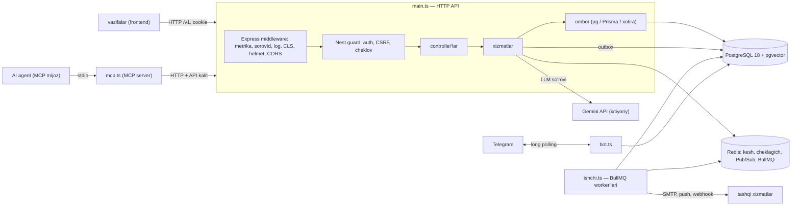

# vazifalar-api — arxitektura xaritasi

Bu hujjat loyihaga yangi qo'shilgan dasturchi uchun. Maqsad — birinchi kunda "nima qayerda" degan savolga javob berish va birinchi
kichik vazifani bir haftada emas, bir kunda tugatish. Batafsil API — [API.md](../API.md), testlar — [TESTLAR.md](../TESTLAR.md),
xavfsizlik qarorlari — [AUTH-QAROR.md](AUTH-QAROR.md), [XAVFSIZLIK.md](XAVFSIZLIK.md).

## 1. Umumiy rasm

`vazifalar-api` — `vazifalar` veb-ilovasining backend'i: NestJS 12 (Express 5 adapteri), TypeScript, PostgreSQL 18 (+ pgvector),
ixtiyoriy Redis. To'rt jarayon bir xil kod bazasidan ishga tushadi:



| Jarayon | Kirish fayli | Buyruq | Nima qiladi |
|---|---|---|---|
| HTTP API | `src/main.ts` | `npm start` | REST `/v1`, `/health/*`, `/metrics`, `/docs` |
| Ishchi | `src/ishchi.ts` | `npm run ishchi` | navbat ishlari: eslatma, email, push, webhook; outbox relay |
| Telegram bot | `src/bot.ts` | `npm run bot` | bot buyruqlari, hisobni ulash |
| MCP server | `src/mcp.ts` | `npm run mcp` | AI agentlar uchun vositalar (REST API'ning mijozi) |

## 2. So'rov yo'li (bitta `POST /v1/vazifalar` misolida)

```mermaid
sequenceDiagram
  participant M as Mijoz
  participant E as Express middleware
  participant N as Nest (guard → pipe → controller)
  participant S as VazifalarService
  participant P as PgOmbori
  participant D as PostgreSQL
  M->>E: POST /v1/vazifalar {matn}
  E->>E: sorovId, log, CLS, helmet, CORS, tezlik cheklovi
  E->>N: KirishGuard (sessiya yoki API kalit), CSRF, SxemaPipe (Zod)
  N->>S: yarat(egasi, matn)
  S->>P: tranzaksiya: set_config(foydalanuvchi_id) → INSERT
  P->>D: RLS — faqat o'z qatorlari; trigger → vazifa_hodisalari
  D-->>P: qator
  S-->>N: domen hodisasi (event-emitter → outbox → SSE/webhook)
  N-->>M: 201 + Location + ETag
```

Xato bo'lsa — hamma joyda bitta shakl: Problem Details (`application/problem+json`, `src/umumiy/problem.filter.ts`).

## 3. Papkalar xaritasi

| Papka | Mas'uliyat | Qaysi qismda paydo bo'lgan |
|---|---|---|
| `src/vazifalar/` | asosiy domen: controller, servis, omborlar (xotira, fayl, pg, Prisma, kesh) | 25–27, 30 |
| `src/auth/` | sessiya, parol (argon2id), 2FA/passkey, OIDC, API kalitlar, RBAC + RLS, CSRF, cheklov | 28, 30 |
| `src/umumiy/` | Problem Details, Zod pipe, idempotentlik, kursor, log, RLS yordamchisi | 25–30 |
| `src/fayl/`, `src/email/`, `src/bildirishnoma/`, `src/push/`, `src/telegram/`, `src/webhook/`, `src/navbat/`, `src/realtime/` | integratsiyalar: S3, SMTP, push, bot, webhook, BullMQ + outbox, SSE | 29, 30 |
| `src/statistika/` | `vazifa_hodisalari` (oyma-oy bo'limlar), faollik statistikasi | 31 |
| `src/ai/` | LLM provayder qatlami, qadamlar, semantik qidiruv, RAG, kvota, kesh, chidamlilik (retry, breaker, deadline) | 31, 32 |
| `src/audit/`, `src/bayroq/` | audit jurnali (hash zanjiri), feature flag'lar | 31 |
| `src/kuzatuv/`, `src/salomatlik/` | Prometheus metrikalari, health | 30, 31 |
| `src/mcp/` | MCP server vositalari | 31 |
| `prisma/` | `schema.prisma`, migratsiyalar (SQL bilan aynan) | 27+ |
| `test/` | Vitest: unit, integratsiya (haqiqiy Postgres/Redis), shartnoma | 25+ |

## 4. Ma'lumotlar

- Sxema manbai — migratsiyalar (`prisma/migrations/`); kurs davomida ular `sql/NNN-*.sql` fayllari bilan AYNAN (tekshiruv: `migrate diff` bo'sh).
- Rollar: `vazifalar_api` (RLS ostida, foydalanuvchi ma'lumoti), `vazifalar_auth` (auth jadvallari), `vazifalar_ishchi` (fon ishlari). Ilova superuser bilan ULANMAYDI.
- `vazifa_hodisalari` — `bolimlar` sxemasida oyma-oy bo'limlar (Prisma'dan tashqarida, `tables.external`); `audit` sxemasi — faqat qo'shiladigan jurnal.

## 5. Lokal ishga tushirish (30 daqiqada)

1. Node 24, Docker. `npm ci` (postinstall — `prisma generate`).
2. Postgres 18 + pgvector va Redis — [README](../README.md#tez-boshlash) dagi `docker run` buyruqlari (faqat `127.0.0.1`).
3. `cp .env.example .env` → `SAQLASH=postgres`, `DATABASE_URL`, `REDIS_URL`.
4. `npm run db:migrate && npm run db:seed` → `npm run start:dev` → `http://127.0.0.1:3000/docs`.
5. `npm run check` — tip, lint, test, build. Yashil bo'lmasa — PR ochilmaydi.

## 6. Birinchi vazifa: qanday boshlash

1. Issue'lardan `good first issue` yorlig'idagisini oling, issue'da "men olaman" deb yozing (ikki kishi bir ishni qilmasin).
2. Avval **o'qing**: issue'da tilga olingan fayl va uning testi. `git log -p --follow <fayl>` — fayl qanday o'zgargan va nega (commit xabarlari).
3. Branch: `git switch -c fix/<qisqa-nom>` (`fix/`, `feat/`, `docs/` — commit turi bilan bir xil; to'liq qoidalar — [CONTRIBUTING.md](../CONTRIBUTING.md)).
4. Avval yiqiladigan test, keyin kod. `npm run check`.
5. Kichik PR (≈ 200 qatordan kam), shablon bo'yicha tavsif. Savol tug'ilsa — PR'ni draft qilib oching va so'rang.

Savollar ro'yxati (birinchi haftada so'rash odatiy): qaysi muhitlar bor (lokal, staging, prod)? kim review qiladi? reliz qachon? qaysi metrikaga
qaraladi? "Bilmayman" — normal javob; yozib qo'yilmagan bilim — hujjatga aylantirish uchun birinchi nomzod.
